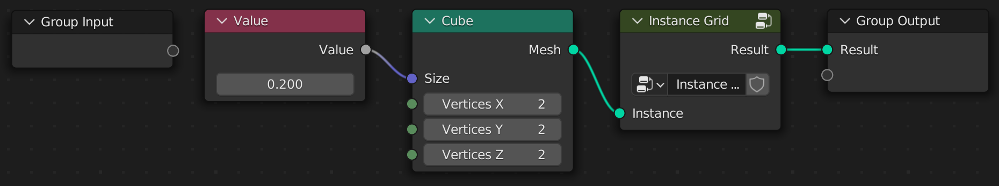
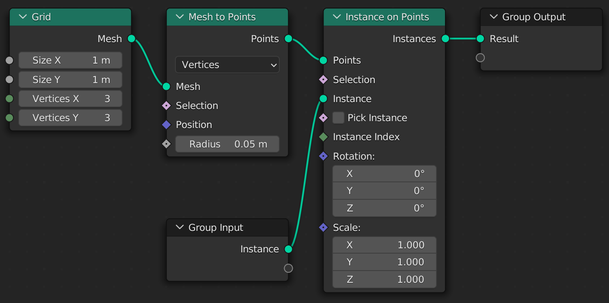

# Node Groups

A Geometry Script can have more than one tree function. Each tree function is a node group, and tree functions can be used in other tree functions to create *Node Group* nodes.

```python
@tree("Instance Grid")
def instance_grid(instance: Geometry):
    """ Instance the input geometry on a grid """
    points = mesh_to_points(mesh=grid().mesh).points
    return instance_on_points(points=points, instance=instance).instances

@tree("Cube Grid")
def cube_grid():
    """ Create a grid of cubes """
    return instance_grid(instance=cube(size=(0.2, 0.2, 0.2)).mesh)
```

The *Cube Grid* tree uses the *Instance Grid* node group by calling the `instance_grid` function:



The *Instance Grid* node group uses the passed in `instance` argument to create a grid of instances:



Unlike node functions, tree functions accept positional arguments as well, in the order of their parameters: `instance_grid(cube(...).mesh)`. Arguments you leave out use the parameter's default.

A group with a single output returns that socket directly. A group with several outputs returns a named tuple with a field for each output. The field names are the output names, with any characters that can't be used in a Python name replaced by underscores (an output named *Bounding Box* becomes `.Bounding_Box`):

```python
@tree("Measure")
def measure(geometry: Geometry):
    bounds = bounding_box(geometry=geometry)
    return {"Size": bounds.max - bounds.min, "Center": (bounds.max + bounds.min) / 2}

@tree("Centered")
def centered(geometry: Geometry):
    center = measure(geometry).Center
    return set_position(geometry=geometry, offset=-center).geometry
```

Define a tree function before any tree that uses it, since each tree is built when its function is decorated.

This concept can scale to complex interconnected node trees, while keeping everything neatly organized in separate functions.

## Functions vs Node Groups

You do not have to mark a function with `@tree(...)`. If you don't, function calls are treated as normal in Python. Any nodes created in the callee will be placed in the caller's tree.

```python
def instance_grid(instance): # Not marked with `@tree(...)`
    points = mesh_to_points(mesh=grid().mesh).points
    return instance_on_points(points=points, instance=instance).instances

@tree("Cube Grid")
def cube_grid(): # Marked with `@tree(...)`
    return instance_grid(cube(size=(0.2, 0.2, 0.2)).mesh)
```

The above example would place the *Grid*, *Mesh to Points*, and *Instance on Points* nodes in the main "Cube Grid" tree. It could be rewritten as:

```python
@tree("Cube Grid")
def cube_grid():
    points = mesh_to_points(mesh=grid().mesh).points
    return instance_on_points(points=points, instance=cube(size=(0.2, 0.2, 0.2)).mesh).instances
```

Plain Python functions are a good way to reuse a few nodes without creating a separate node group.
