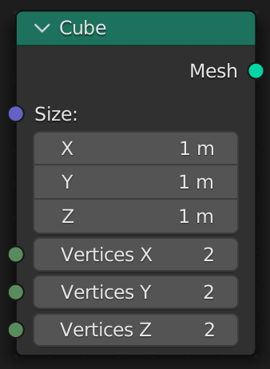
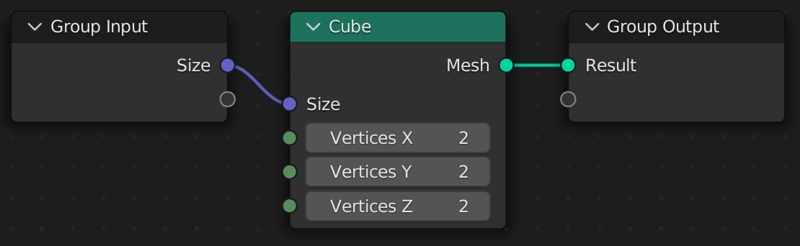
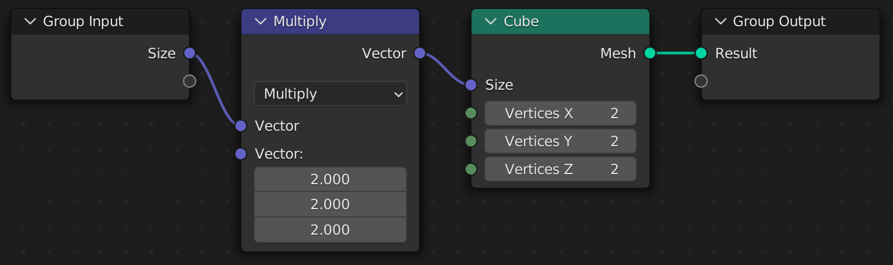
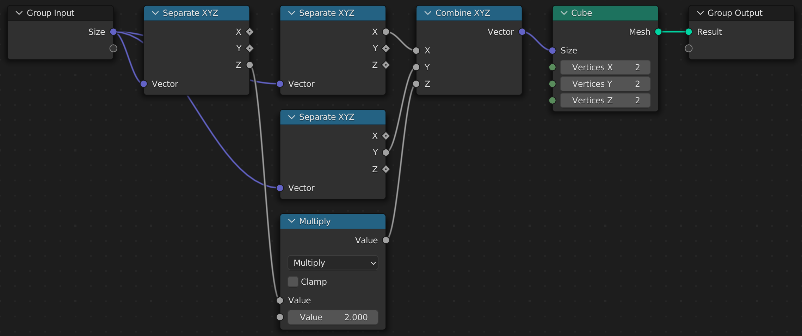
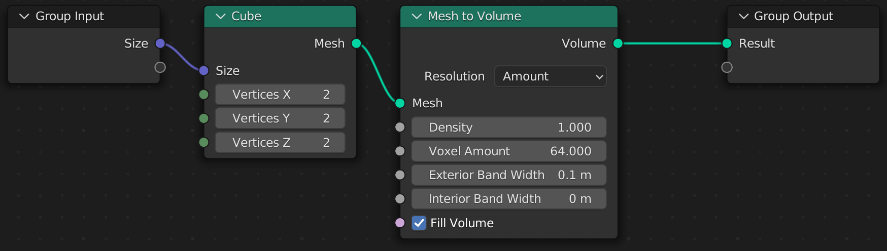

# Sockets
Because scripts are converted to Geometry Node trees, the values you work with in a script are not concrete numbers or meshes. They are sockets.

## What is a socket?
A socket is any input or output on a node. Take the *Cube* node for example:



This node has 4 input sockets, and 2 output sockets.

* Input Sockets
    * Size: `Vector`
    * Vertices X: `int`
    * Vertices Y: `int`
    * Vertices Z: `int`
* Output Sockets
    * Mesh: `Geometry`
    * UV Map: `Field[Vector]`

A socket does not represent a value itself. For example, the `Size` socket does not necessarily represent the value `(1, 1, 1)`. Instead, it can be connected to another node as an input, giving it a dynamic value.

When we write scripts, we typically deal with sockets, not concrete values like `(1, 1, 1)`. Take this script for example:

```python
@tree("Cube Tree")
def cube_tree(size: Vector):
    return cube(size=size).mesh
```

The `size` argument creates an input socket with the type `Vector`. This is then connected to the `size` socket of the *Cube* node.



Our script does not run every time the node tree is evaluated. It only runs once to create the node tree. Therefore, we have no way of knowing what value `size` has when the script runs, because it is dynamic.

## What sockets *can* do

Sockets are great for passing values between nodes. A `Geometry` socket does not represent concrete vertices, edges, and faces. Instead, it represents the input or output socket of a node. This lets us use it to create connections between different nodes, by passing the output of one node to the input of another.

## What sockets *cannot* do

Sockets cannot be read for their concrete value. A `float` socket does not equal `5` or `10` or `3.14` to our script. If you try to `print(...)` a socket, you will see which node and socket it refers to, such as `Socket(Cube.Mesh)`, but no value.

For the same reason, Python's `if`, `and`, `or` and `not` cannot look at a socket's value. Use nodes such as *Switch*, *Compare* and *Boolean Math* instead.

## Literals

Anywhere a node input accepts a socket, you can also pass a Python value. It is stored as the input's value:

```python
cube(size=(2.0, 2.0, 2.0), vertices_x=4)
```

A tuple that contains sockets is combined for you with a *Combine XYZ* (or *Combine Color*) node:

```python
@tree("Cube Tree")
def cube_tree(height: float):
    return cube(size=(1.0, 1.0, height)).mesh
```

## Socket Math

Sockets can be used in math expressions. The proper *Math* node will be created automatically for you, so you can focus on writing a script and not thinking about sockets. If you use a `float` or `int` socket it will create a *Math* node, and if you use a `Vector` socket it will create a *Vector Math* node.

```python
@tree("Cube Tree")
def cube_tree(size: Vector):
    doubled = size * (2, 2, 2) # Multiply each component by 2
    return cube(size=doubled).mesh
```


These operators are available:
* Add (`socket + 2`)
* Subtract (`socket - 2`)
* Multiply (`socket * 2`)
* Divide (`socket / 2`)
* Modulo (`socket % 2`)
* Power (`socket ** 2`)
* Negate (`-socket`)

For any other operation, call the node function directly:

```python
math_(operation="SINE", value=angle).value
vector_math(operation="NORMALIZE", vector=direction).vector
```

## Comparisons

Comparison operators such as `<` and `==` are *not* overloaded on sockets, since Python would need a concrete `True` or `False`. Use the *Compare* node:

```python
is_tall = compare(a=height, b=2.0, operation="GREATER_THAN").result
```

See [Boolean Math](../advanced-scripting/boolean-math.md) for combining the results.

## Vector Components

To read the `x`, `y`, and `z` components of a `Vector` socket, use a *Separate XYZ* node:

```python
@tree("Cube Tree")
def cube_tree(size: Vector):
    components = separate_xyz(vector=size)
    # Multiply the height by 2 but leave the other components unchanged.
    return cube(size=(components.x, components.y, components.z * 2)).mesh
```



## Connecting Nodes

To use the output of one node as the input of another, pass the output socket as a keyword argument:

```python
@tree("Cube Tree")
def cube_tree(size: Vector):
    mesh = cube(size=size).mesh
    return mesh_to_volume(mesh=mesh).volume
```

The *Mesh* output of the *Cube* node is connected to the *Mesh* input of the *Mesh to Volume* node.



Storing intermediate sockets in variables keeps longer trees readable, and lets you connect one output to several inputs.
