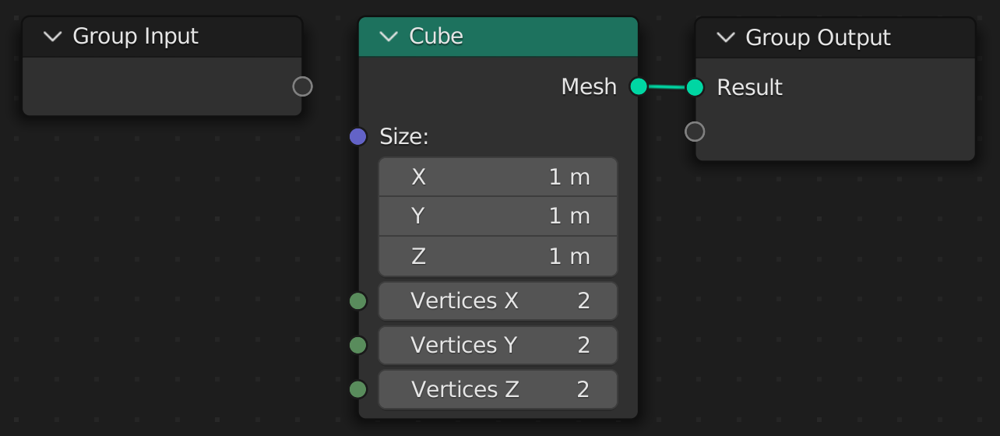
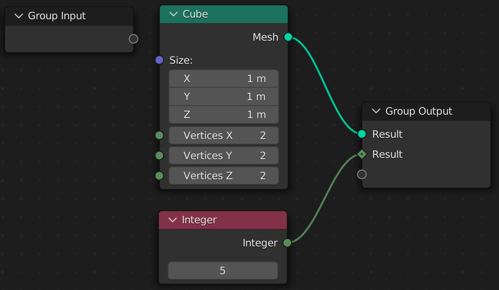
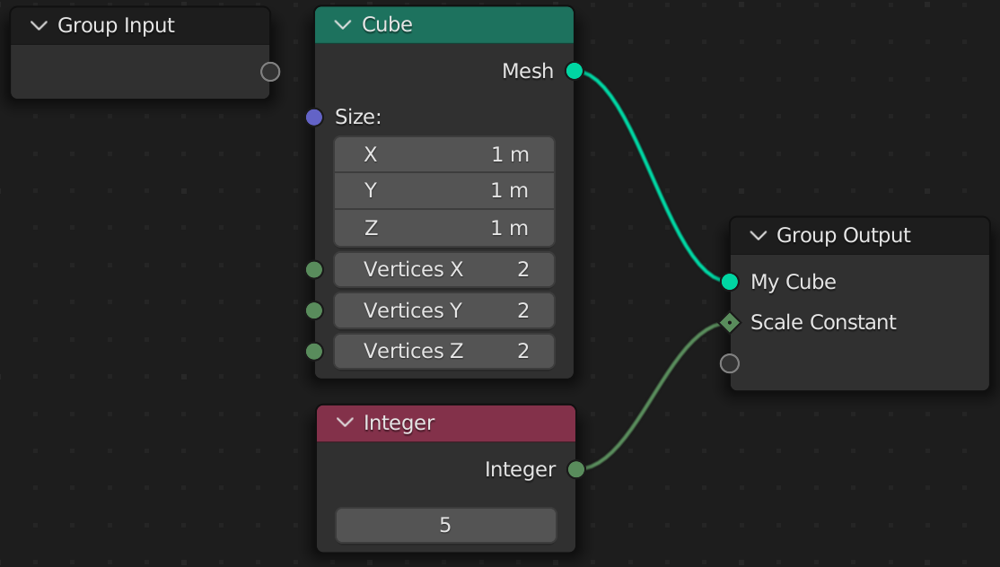
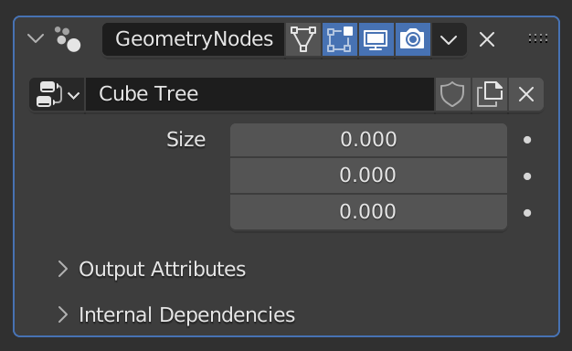
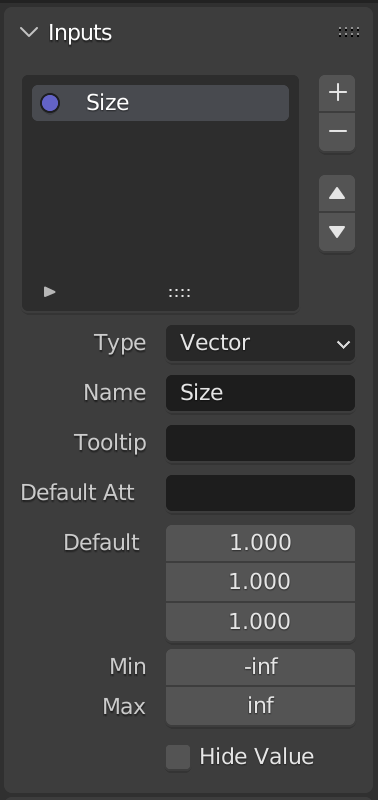

# Tree Functions

Node trees are created by decorating a function with `@tree`. Let's try creating a simple tree function.

> The code samples for the rest of the book assume you are importing all names with `from geometry_script import *`. However, if you are using a namespaced import, simply prefix the functions and types with `geometry_script` or your custom name.

```python
@tree
def cube_tree():
    ...
```

By default, the name of your function will be used as the name of the generated node tree. However, you can specify a custom name by passing a string to `@tree`:

```python
@tree("Cube Tree")
def cube_tree():
    ...
```

Running the script again rebuilds the tree in place. Modifiers using the tree keep their input values, and if the script raises an error, the previous version of the tree is left untouched.

The nodes are laid out for you each time the tree is built, in columns that flow from the *Group Input* on the left to the *Group Output* on the right, with each zone's nodes kept together. Shader and compositor groups, materials and worlds are arranged the same way.

## Group Output
The values you return become the outputs of the tree. Let's try returning a simple cube.

```python
@tree("Cube Tree")
def cube_tree():
    return cube().mesh
```

Here we call the `cube(...)` function, which creates a *Cube* node. Node functions return their outputs as a named tuple, so `.mesh` picks the *Mesh* output and connects it to the *Group Output*.



The *Geometry Nodes* modifier displays the first output, so a tree used as a modifier should return `Geometry` first.

You can also return multiple values as a tuple.

```python
@tree("Cube Tree")
def cube_tree():
    return cube().mesh, 5
```



By default, the outputs are named *Result*, *Result 2*, and so on. To customize the names, return a dictionary.

```python
@tree("Cube Tree")
def cube_tree():
    return {
        "My Cube": cube().mesh,
        "Scale Constant": 5
    }
```



## Group Input
Each argument of a tree function becomes an input socket. Its annotation chooses the socket type. Let's add a size argument to our Cube Tree.

```python
@tree("Cube Tree")
def cube_tree(size: Vector):
    return cube(size=size).mesh
```

This creates a *Size* socket on the *Group Input* node and connects it to our cube.


The option is available on the Geometry Nodes modifier.



The available socket types match those in the UI. Python's built-in types are used for the basic ones:

| Annotation | Socket |
|---|---|
| `float` | Float |
| `int` | Integer |
| `bool` | Boolean |
| `str` | String |
| `Vector`, `Vector2`, `Vector4` | Vector (3, 2 or 4 dimensions) |
| `Color` | Color |
| `Rotation` | Rotation |
| `Matrix` | Matrix |
| `Menu` | Menu |
| `Geometry` | Geometry |
| `Object`, `Collection`, `Material`, `Image` | Data-block |
| `Bundle`, `Closure` | Bundle, Closure |

Wrap a type in `Field[...]`, `Grid[...]` or `List[...]` to set the socket's structure type, e.g. `offset: Field[float]` for an input that accepts a field.

In the next chapter, we'll take a closer look at how sockets work, and what you can and cannot do with them.

### Default Values
You can specify a default for any argument, and it will be set on the modifier when added:

```python
@tree("Cube Tree")
def cube_tree(size: Vector = (1.0, 1.0, 1.0)):
    return cube(size=size).mesh
```


If an argument has a default but no annotation, its type is inferred from the default: `count=4` becomes an Integer input and `scale=0.5` a Float input.
