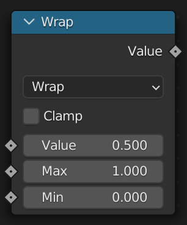
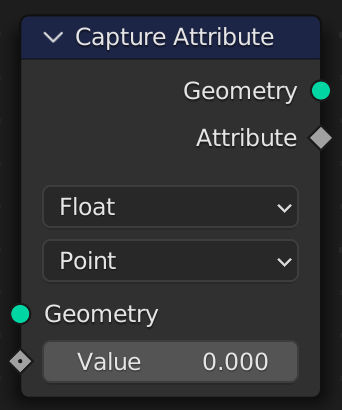

# Using Nodes

Node functions are generated from the Blender version the extension is built for. Every node in that version is available, with the exact inputs, outputs and options it has there.

## How nodes are mapped
All nodes are mapped to functions in the same way, so you can usually guess what a node is called. Using an [IDE with code completion](../../setup/external-editing.md) makes this even easier.

1. The function name is the node's name in snake case: *Mesh to Points* is `mesh_to_points`.
2. Each input and property is a **keyword argument**, also in snake case. Node functions do not take positional arguments.
3. The function returns a named tuple with one field per output, again in snake case.

```python
result = mesh_to_points(mesh=grid().mesh, radius=0.1)
result.points # The Points output
```

> Properties and inputs are both keyword arguments. A property is a value that cannot be connected to a socket. These are typically enums (displayed in the UI as a dropdown), with specific string values expected.

### Names that clash with Python
Names that would hide a Python builtin get a trailing underscore: `math_`, `id_`, `object_` and `string_`. `math(...)` also works for the *Math* node, while `math.pi` and the other members of Python's `math` module keep working too.

## Finding Nodes

To search the available nodes, or to print the signature of a node, use the `describe` tool from the repository. It doesn't need Blender to run:

```sh
python3 tools/describe.py --search "points on faces"
python3 tools/describe.py mesh_to_points
```

```
mesh_to_points  # Mesh to Points: Generate a point cloud from a mesh's vertices
  mesh: Geometry
  selection: bool field = True
  position: Vector field = (0, 0, 0)
  radius: float field = 0.05
  mode: VERTICES|EDGES|FACES|CORNERS = 'VERTICES'
  -> .points: Geometry
```

Inside Blender, `agent.search(...)` and `agent.describe(...)` print the same thing:

```python
from geometry_script import agent
agent.describe("mesh_to_points", "set_position")
```

## Enum Properties

Many nodes have enum properties. For example, the *Math* node lets you choose which operation to perform. Pass the enum value as a string:

```python
math_(operation="ADD", value=1.0, value_2=2.0)
math_(operation="SUBTRACT", value=1.0, value_2=2.0)
```

The allowed values are part of the function's type hints, so they appear in code completion and a type checker will flag a typo. If you pass an invalid value, the error lists the valid ones:

```
Cannot set ShaderNodeMath.operation to 'SUBSTRACT'. Expected one of ['ADD', 'SUBTRACT', ...]. Did you mean 'SUBTRACT'?
```

Some nodes use *Menu* inputs instead of enum properties. These are passed as strings as well, using the name shown in the UI:

```python
distribute_points_in_volume(volume=volume, mode="Grid")
```

## Data Types

Nodes such as *Switch*, *Capture Attribute*, *Random Value* or *Store Named Attribute* can work with several data types. You usually don't need to set `data_type` or `input_type`: it is inferred from what you connect.

```python
# input_type is inferred as 'GEOMETRY'
switch(switch=use_sphere, false=cube().mesh, true=uv_sphere().mesh).output
# data_type is inferred as 'FLOAT_VECTOR'
random_value(min=(0.0, 0.0, 0.0), max=(1.0, 1.0, 1.0)).value
```

Set it explicitly to override the inferred type:

```python
named_attribute(name="height", data_type="FLOAT").attribute
```

## Duplicate Names

Some nodes use the same input name multiple times. For example, the *Math* node has three inputs named *Value*. The second and third get a number: `value`, `value_2` and `value_3`.

```python
math_(operation="WRAP", value=0.5, value_2=1.0, value_3=0.0)
```



## Outputs That Depend on Settings

Some outputs only exist with certain settings. The *Vector Math* node, for example, outputs a *Value* instead of a *Vector* for `DOT_PRODUCT`. Accessing an output that the node doesn't have with its current settings raises an error naming the outputs that do exist:

```
'Vector Math' has no 'vector' output with its current settings {'operation': 'DOT_PRODUCT'}; available: ['value'].
```

## Examples

Here are two examples to show how a node maps to a function.

### Cube


1. Name: `Cube` -> `cube`
2. Keyword Arguments
    * `size: Vector`
    * `vertices_x: int`
    * `vertices_y: int`
    * `vertices_z: int`
3. Returns `.mesh: Geometry` and `.uv_map: Field[Vector]`

The node can now be used as a function:

```python
cube() # All arguments are optional
cube(size=(1.0, 1.0, 1.0), vertices_x=3) # Optionally specify keyword arguments
cube_mesh = cube().mesh # Pick the Mesh output
```

### Capture Attribute



Some nodes, such as *Capture Attribute*, have a list of items you add yourself. Their items are passed as extra keyword arguments, and each item's output is available by the same name:

1. Name `Capture Attribute` -> `capture_attribute`
2. Keyword Arguments
    * `geometry: Geometry`
    * `selection: Field[bool]`
    * `domain: 'POINT' | 'EDGE' | 'FACE' | ...`
    * Any number of items, by name
3. Returns `.geometry: Geometry` plus one output per item

```python
result = capture_attribute(geometry=cube_mesh, domain="FACE", normal=normal().normal)
result.geometry # Access the geometry
result.normal # Access the captured normal
```

See [Item Nodes](../advanced-scripting/item-nodes.md) for the other nodes that work this way.
