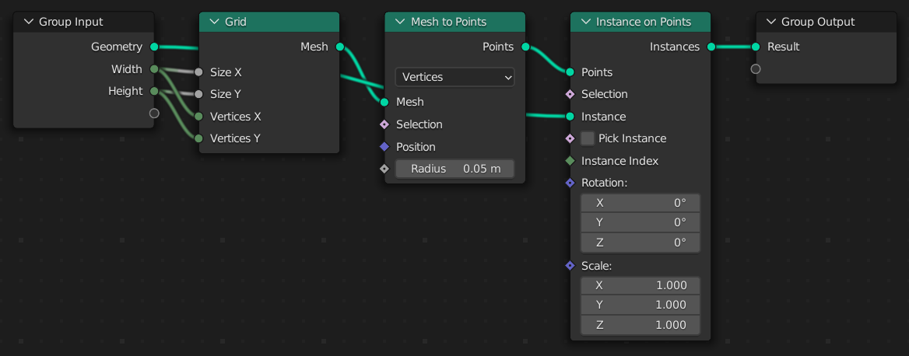

# Introduction

**Geometry Script** is a scripting API for Blender's Geometry Nodes.
It makes complicated node trees more manageable and easy to share.

* [Full coverage of nodes](./api/basics/using-nodes.md) available in your Blender version
* Clean, easy to use [Python API](./api/basics.md)
* Typed node functions generated from your Blender version, with [errors that say what to change](./api/basics/using-nodes.md)
* External [IDE integration](./setup/external-editing.md) for better completions and hot reload
* [Repeat, simulation, for-each and closure zones](./api/advanced-scripting/repeat-zones.md)

Here's a simple example of what's possible with a short script:

### Geometry Script

```python
from geometry_script import *

@tree("Repeat Grid")
def repeat_grid(geometry: Geometry, width: int = 3, height: int = 3):
    mesh = grid(
        size_x=width, size_y=height,
        vertices_x=width, vertices_y=height,
    ).mesh
    points = mesh_to_points(mesh=mesh).points
    return instance_on_points(points=points, instance=geometry).instances
```

### Generated Node Tree

