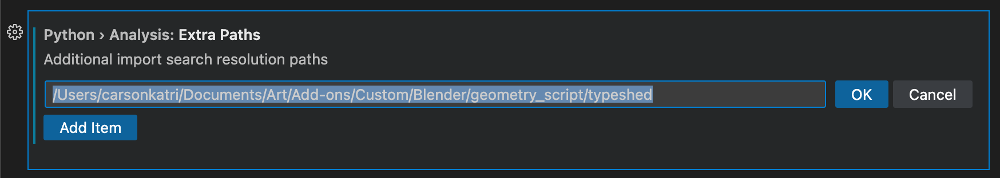
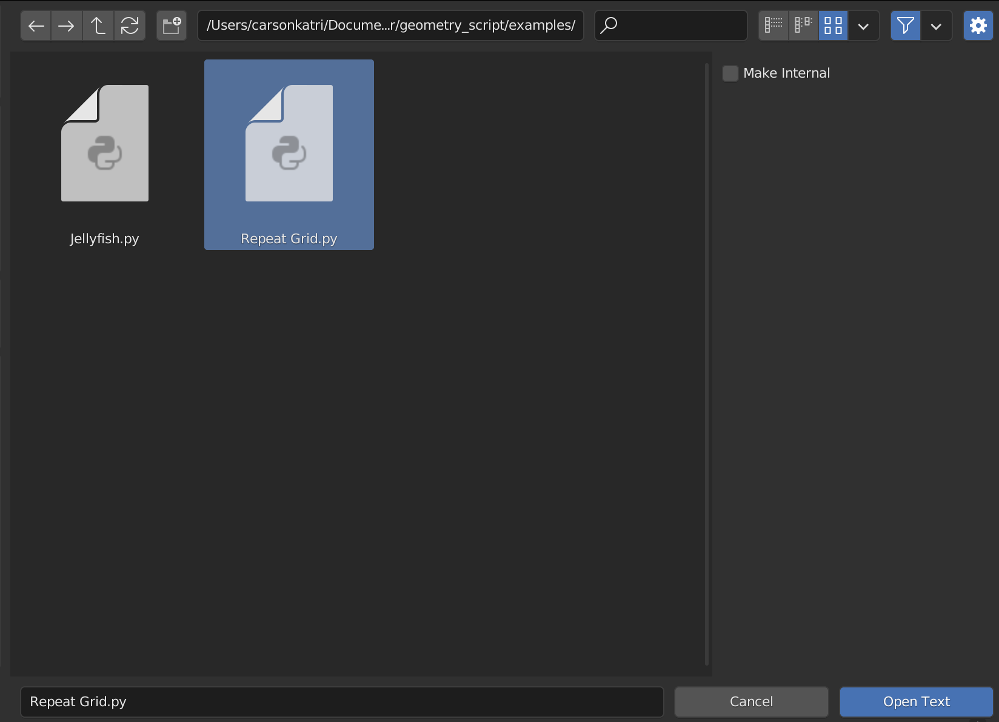
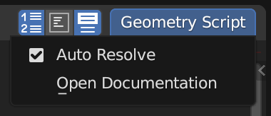
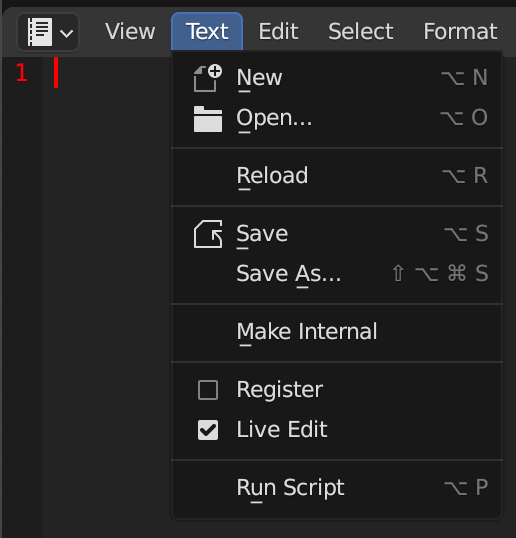

# External Editing

Blender's *Text Editor* leaves a lot to be desired. Writing scripts without code completion can be tough.
Using an external code editor is one way to improve the editing experience.

This guide will show how to setup [Visual Studio Code](https://code.visualstudio.com/) to edit Geometry Scripts. However, the same concepts apply to other IDEs.

> This guide assumes you have already installed Visual Studio Code and setup the [Python extension](https://marketplace.visualstudio.com/items?itemName=ms-python.python). If not, please setup those tools before continuing.

## Code Completion
Every node function in Geometry Script is generated with full type hints: its keyword arguments, their socket types and defaults, the allowed enum values, and a named tuple of its outputs. An editor only needs to find the `geometry_script` package to complete all of them.

1. Find the folder Blender installed the extension into. For the default user repository this is the `extensions/user_default` folder inside Blender's configuration directory:
    * Linux: `~/.config/blender/5.2/extensions/user_default`
    * macOS: `~/Library/Application Support/Blender/5.2/extensions/user_default`
    * Windows: `%APPDATA%\Blender Foundation\Blender\5.2\extensions\user_default`

    It contains a `geometry_script` folder.
2. In VS Code, open the Settings UI (`Shift+CTRL+P` or `Shift+CMD+P` > `Preferences > Open Settings (UI)`)
3. Find the setting `Python > Analysis: Extra Paths`
4. Click *Add Item*, then paste in the `user_default` path and click *OK*



5. Create a new Python file, such as `Repeat Grid.py` and start writing a script. As you type, you should get helpful suggestions for every available node. Hovering a node function shows its signature and description, for example:

```python
def instance_on_points(
    *,
    points: Geometry | Socket[Geometry] | None = None,
    selection: bool | Field[bool] | Socket[bool | Field[bool]] = True,
    instance: Geometry | Socket[Geometry] | None = None,
    pick_instance: bool | Field[bool] | Socket[bool | Field[bool]] = False,
    instance_index: int | Field[int] | Socket[int | Field[int]] = 0,
    rotation: Rotation | Field[Rotation] | Socket[Rotation | Field[Rotation]] = (0.0, 0.0, 0.0),
    scale: Vector | Field[Vector] | Socket[Vector | Field[Vector]] = (1.0, 1.0, 1.0),
) -> GeometryNodeInstanceOnPointsOutputs:
    'Generate a reference to geometry at each of the input points, without duplicating its underlying data'
```

> For completions of `bpy` itself, install [`fake-bpy-module`](https://github.com/nutti/fake-bpy-module) into the Python environment your editor uses.

## Linking with Blender
Writing a script is great, but we want to see it run in Blender. Thankfully, Blender's Text Editor lets us link with an external file, and a simple tool from Geometry Script can make the process more seamless:

1. Open a *Text Editor* space.
2. Click the open button in the top of the editor, and navigate to your Python file.
3. Click the gear icon or press *N*, and uncheck *Make Internal*. This will ensure that changes made outside of Blender can be easily brought in.
4. Click *Open Text*.



5. At the top right of the Text Editor, open the *Geometry Script* menu and enable *Auto Resolve*. Enabling this feature will make the text data-block in Blender update every time you save the file outside of Blender.



6. To enable hot reload, open the *Text* menu and enable *Live Edit*. This will re-run your Geometry Script whenever it changes, updating the node tree live.



Each live reload prints a short report to Blender's system console: the trees that were built with their inputs and outputs, then the evaluated geometry (vertex, face, point and instance counts and bounds) and any node warnings for every object using them. If the script fails, the report shows the error and the line that caused it, and the previous tree is kept.

And that's it! You're setup to start writing scripts. In the next section we'll take a look at the API, and all of the things you can do with it.