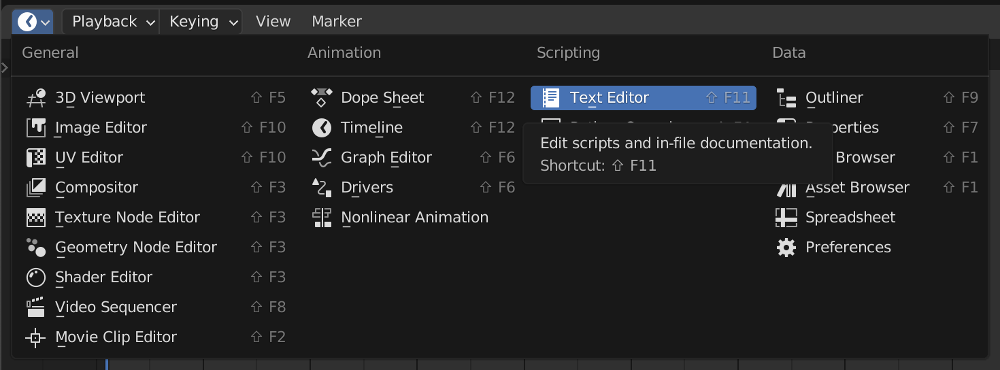
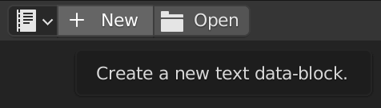
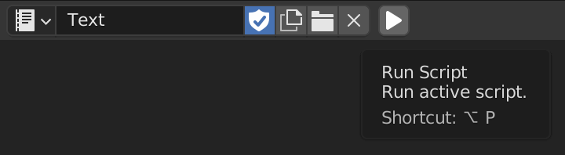
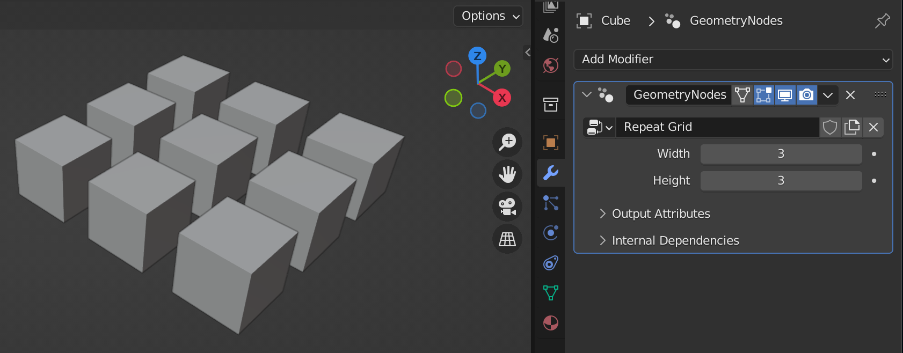

# Internal Editing Basics

The fastest way to get up and running is with Blender's built-in *Text Editor*.
You can edit and execute your scripts right inside of Blender:

1. Open a *Text Editor* space.



2. Create a new text data-block with the *New* button.



3. Start writing a Geometry Script. As an example, you can paste in the script below. More detailed instructions on writing scripts are in later chapters.

```python
from geometry_script import *

@tree("Repeat Grid")
def repeat_grid(geometry: Geometry, width: int = 3, height: int = 3):
    mesh = grid(
        size_x=width, size_y=height,
        vertices_x=width, vertices_y=height,
    ).mesh
    points = mesh_to_points(mesh=mesh).points
    return instance_on_points(points=points, instance=geometry).instances
```

4. Click the run button to execute the script. This will create a Geometry Nodes tree named *Repeat Grid*.



5. Create a *Geometry Nodes* modifier on any object in your scene and select the *Repeat Grid* tree.

If the script has a mistake, Blender reports the error (the full traceback is in the system console) and the previous version of the tree is left untouched. Errors name what to change, such as a misspelled input (`unexpected keyword argument 'vertice_x'. Did you mean 'vertices_x'?`) or an output that doesn't exist (`GeometryNodeMeshGridOutputs has no output 'geometry'; available: ['mesh', 'uv_map']`).

