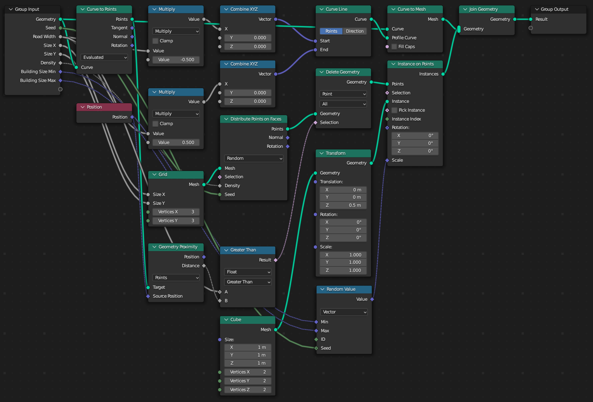

# City Builder

In this tutorial we'll create a dense grid of buildings, then cut away from them to place roads with curves. We'll then join the buildings and the roads into a single geometry.


## Setting Up
Create a Bezier Curve object. You can enter edit mode and delete the default curve it creates.

Then create a new script. Setting up an [external editor](../setup/external-editing.md) is recommended.

Import Geometry Script, and create a basic tree builder function. We'll add a few arguments to configure the buildings.

```python
from geometry_script import *

@tree("City Builder")
def city_builder(
    geometry: Geometry,
    building_size_min: Vector = (0.1, 0.1, 0.2),
    building_size_max: Vector = (0.3, 0.3, 1.0),
    size_x: float = 5.0,
    size_y: float = 5.0,
    road_width: float = 0.25,
    seed: int = 0,
    resolution: int = 60,
):
    return geometry
```

Run the script to create the tree, then add a *Geometry Nodes* modifier to your curve object and select the *City Builder* node group.

## Buildings
Let's start with the buildings. We'll distribute points on a grid with `size_x` and `size_y`.

```python
def city_builder(...):
    building_points = distribute_points_on_faces(
        mesh=grid(
            size_x=size_x, size_y=size_y,
            vertices_x=resolution, vertices_y=resolution,
        ).mesh,
        seed=seed,
    ).points
    return building_points
```

Next, we'll instance cubes on these points to serve as our buildings. We move the cube up half its height so the buildings sit flat on the grid, and scale them randomly between the min and max sizes. Passing the point's `id` to *Random Value* gives every building a different size.

```python
def city_builder(...):
    ...
    building = transform_geometry(
        geometry=cube(size=(1.0, 1.0, 1.0)).mesh,
        translation=(0.0, 0.0, 0.5),
    ).geometry
    random_scale = random_value(
        min=building_size_min,
        max=building_size_max,
        seed=seed,
        id=id_().id,
    ).value
    buildings = instance_on_points(
        points=building_points,
        instance=building,
        scale=random_scale,
    ).instances
    return buildings
```

## Roads
Using `curve_to_mesh`, we can turn the input curve into a flat mesh, by sweeping a short line along it. A tuple containing sockets, like `(road_width * -0.5, 0.0, 0.0)`, is combined into a vector for us.

```python
def city_builder(...):
    roads = curve_to_mesh(
        curve=geometry,
        profile_curve=curve_line(
            start=(road_width * -0.5, 0.0, 0.0),
            end=(road_width * 0.5, 0.0, 0.0),
        ).curve,
    ).mesh
    ...
```

To output both the roads and the buildings, join them with `join_geometry`:

```python
def city_builder(...):
    ...
    return join_geometry(geometry=[roads, buildings]).geometry
```

But now the buildings are overlapping the road. We need to remove any point that falls within the road curve. We'll use `geometry_proximity` to measure the distance from each building to the nearest road point, `compare` to check it against the road width, and `delete_geometry` to remove the buildings that are too close.

```python
def city_builder(...):
    road_points = curve_to_points(curve=geometry, mode="EVALUATED").points
    ...
    building_points = ...
    road_distance = geometry_proximity(
        geometry=road_points,
        target_element="POINTS",
        sample_position=position().position,
    ).distance
    building_points = delete_geometry(
        geometry=building_points,
        domain="POINT",
        selection=compare(a=road_distance, b=road_width * 2, operation="LESS_THAN").result,
    ).geometry
    ...
```

## Drawing Roads
Enter edit mode and select the *Draw* tool. Simply draw roads onto your city to see the buildings and meshes update.


## Final Script

```python
from geometry_script import *

@tree("City Builder")
def city_builder(
    geometry: Geometry,
    building_size_min: Vector = (0.1, 0.1, 0.2),
    building_size_max: Vector = (0.3, 0.3, 1.0),
    size_x: float = 5.0,
    size_y: float = 5.0,
    road_width: float = 0.25,
    seed: int = 0,
    resolution: int = 60,
):
    # Road geometry from input curves
    road_points = curve_to_points(curve=geometry, mode="EVALUATED").points
    roads = curve_to_mesh(
        curve=geometry,
        profile_curve=curve_line(
            start=(road_width * -0.5, 0.0, 0.0),
            end=(road_width * 0.5, 0.0, 0.0),
        ).curve,
    ).mesh

    # Randomly distribute buildings on a grid
    building_points = distribute_points_on_faces(
        mesh=grid(
            size_x=size_x, size_y=size_y,
            vertices_x=resolution, vertices_y=resolution,
        ).mesh,
        seed=seed,
    ).points

    # Delete building points that are too close to a road
    road_distance = geometry_proximity(
        geometry=road_points,
        target_element="POINTS",
        sample_position=position().position,
    ).distance
    building_points = delete_geometry(
        geometry=building_points,
        domain="POINT",
        selection=compare(a=road_distance, b=road_width * 2, operation="LESS_THAN").result,
    ).geometry

    # Instance a randomly scaled cube on each remaining point
    building = transform_geometry(
        geometry=cube(size=(1.0, 1.0, 1.0)).mesh,
        translation=(0.0, 0.0, 0.5),
    ).geometry
    random_scale = random_value(
        min=building_size_min,
        max=building_size_max,
        seed=seed,
        id=id_().id,
    ).value
    buildings = instance_on_points(
        points=building_points,
        instance=building,
        scale=random_scale,
    ).instances

    return join_geometry(geometry=[roads, buildings]).geometry
```

## Generated Node Tree

