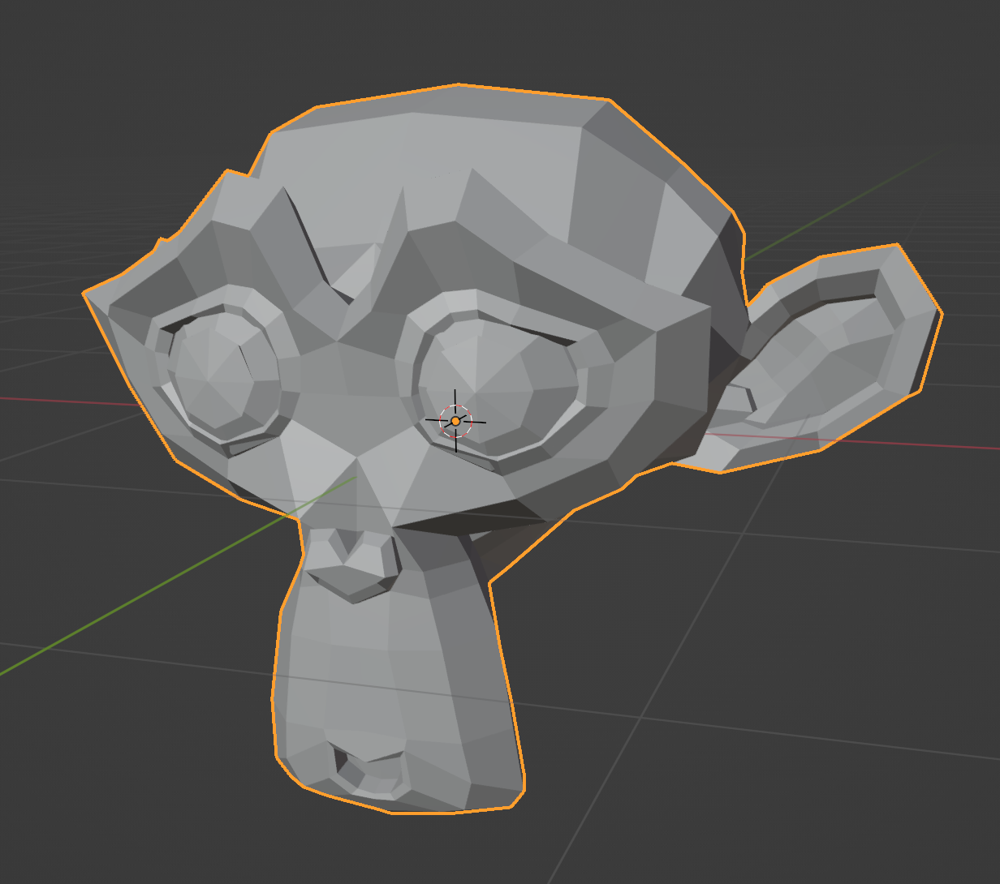
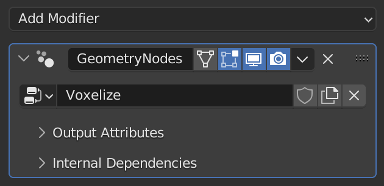
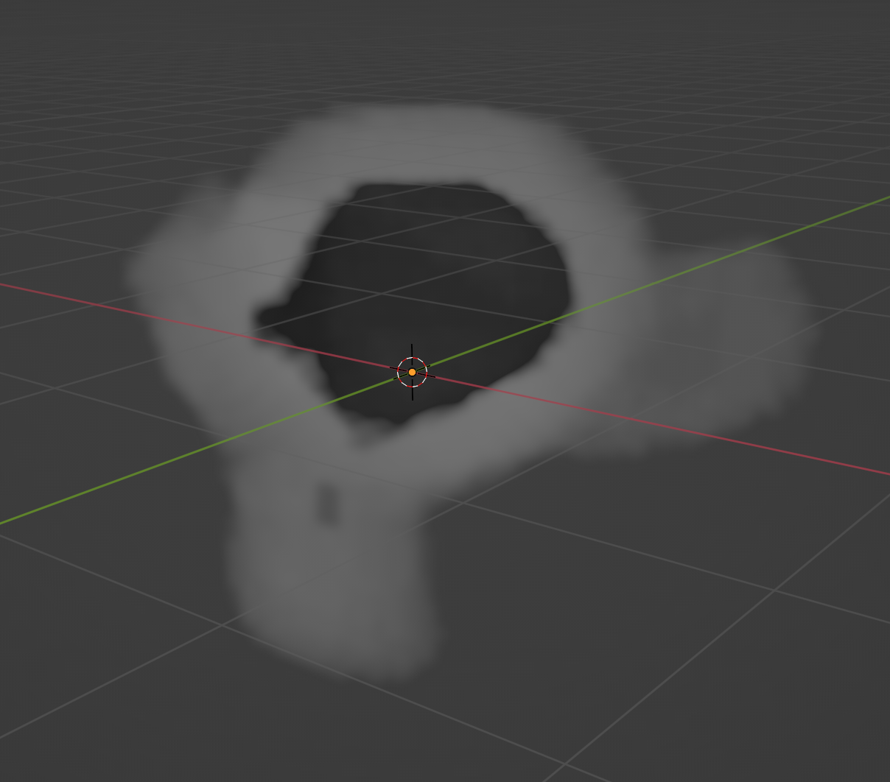
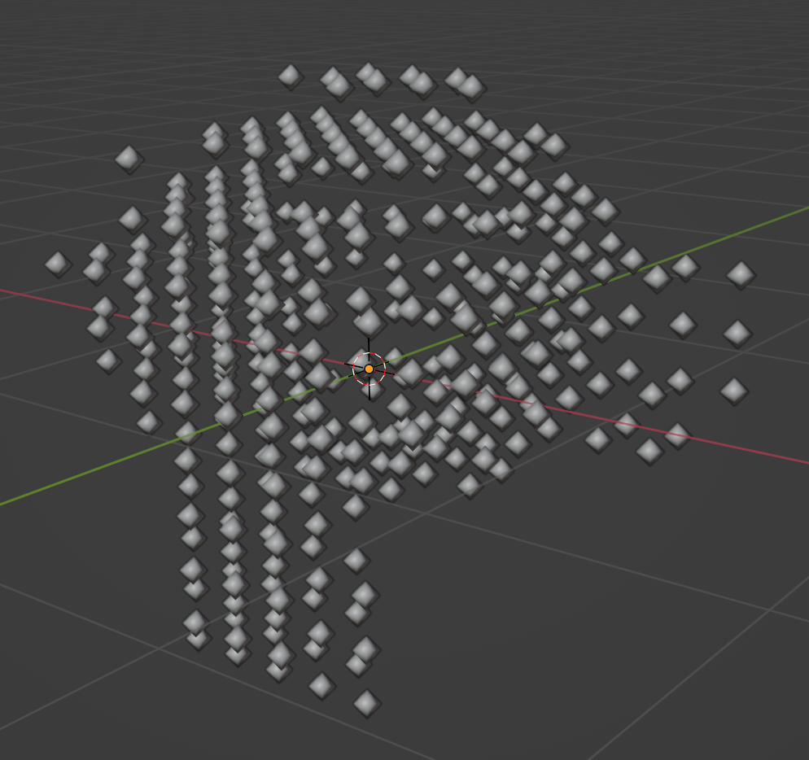
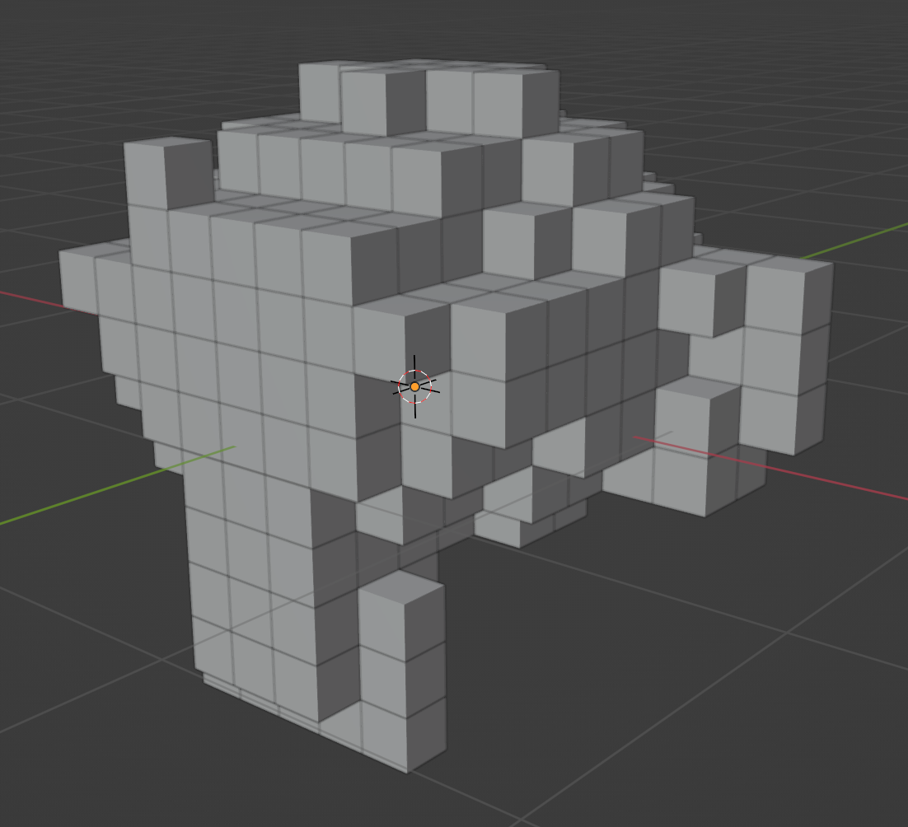
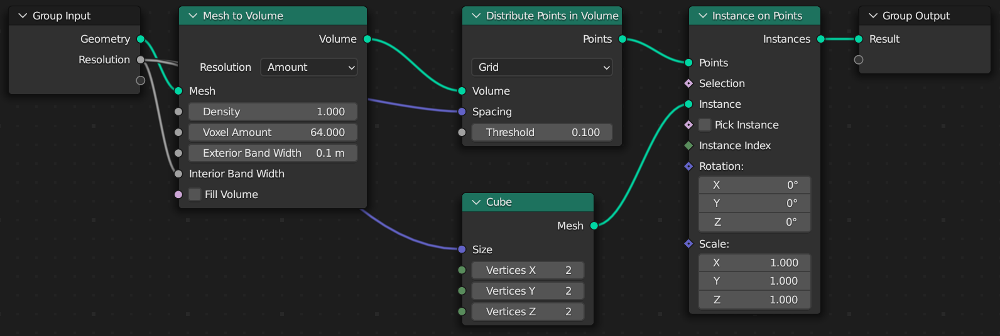

# Voxelize

This tutorial walks you through creating a script that turns any mesh into voxels.

## Setting Up
Create a base mesh. I'll be using a Monkey primitive.



Next, create a new script. Setting up an [external editor](../setup/external-editing.md) is recommended.

Import Geometry Script, and create a basic tree builder function. We'll add a `geometry` argument and annotate it with the `Geometry` type to receive our base mesh (in this case, a monkey).

```python
from geometry_script import *

@tree("Voxelize")
def voxelize(geometry: Geometry):
    return geometry
```

Run the script to create the tree, then add a *Geometry Nodes* modifier to your mesh and select the *Voxelize* node group.



## Arguments
Add a new argument `resolution: float`. Give it a default value of `0.2`. This value will be used throughout the script to configure spacing and voxel density.

```python
def voxelize(geometry: Geometry, resolution: float = 0.2):
    ...
```

## Mesh to Volume
We want to convert the mesh to a volume, so we can fill its inside with points.

Use the `mesh_to_volume` function on the base mesh to convert it to a volume.

```python
def voxelize(geometry: Geometry, resolution: float = 0.2):
    volume = mesh_to_volume(mesh=geometry, interior_band_width=resolution).volume
    return volume
```



## Volume to Points
Next, we need to create points to instance each voxel cube on. Use `distribute_points_in_volume` with the mode set to `Grid` to create a uniform distribution of points. Its `spacing` is a vector, so we pass `resolution` for each axis.

```python
def voxelize(geometry: Geometry, resolution: float = 0.2):
    volume = mesh_to_volume(mesh=geometry, interior_band_width=resolution).volume
    points = distribute_points_in_volume( # Uniform grid distribution
        volume=volume,
        mode="Grid",
        spacing=(resolution, resolution, resolution),
    ).points
    return points
```



## Instance Cubes
Finally, use `instance_on_points` with a cube of size `resolution` to instance a cube on each point created from our mesh.

```python
def voxelize(geometry: Geometry, resolution: float = 0.2):
    ...
    voxel = cube(size=(resolution, resolution, resolution)).mesh
    return instance_on_points(points=points, instance=voxel).instances # Cube instancing
```



You can lower the resolution to get smaller, more detailed voxels, or raise it to get larger voxels.

## Final Script

```python
from geometry_script import *

@tree("Voxelize")
def voxelize(geometry: Geometry, resolution: float = 0.2):
    volume = mesh_to_volume(mesh=geometry, interior_band_width=resolution).volume
    points = distribute_points_in_volume(
        volume=volume,
        mode="Grid",
        spacing=(resolution, resolution, resolution),
    ).points
    voxel = cube(size=(resolution, resolution, resolution)).mesh
    return instance_on_points(points=points, instance=voxel).instances
```

## Generated Node Tree

